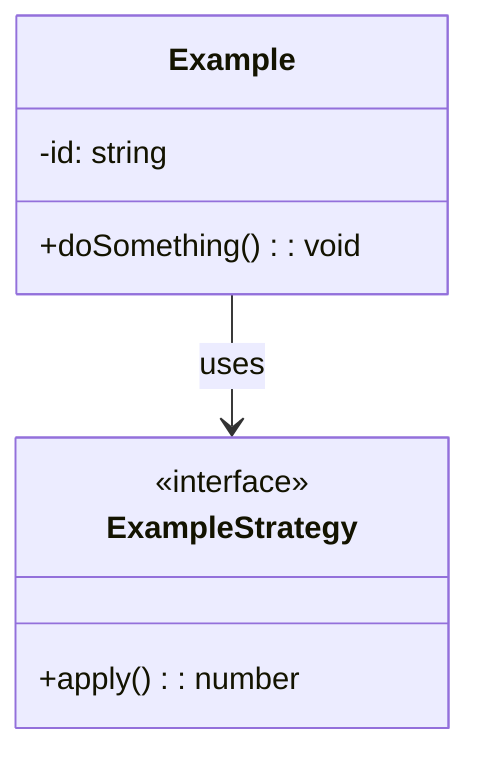

# <Problem Name>

## Requirements
**Functional**
- ...

**Out of scope**
- ...

**Assumptions**
- ...

## Entities and relationships
| Entity | Responsibility |
|---|---|
| ... | ... |

## Class diagram


## Patterns used
- **Pattern**: why this requirement needed it

## Concurrency and edge cases
- ...

## Extension tried
- Follow-up requirement and how it plugged in (or what had to change and why)

## Run
```bash
npx ts-node <problem-name>/src/index.ts
npx jest <problem-name>
```
