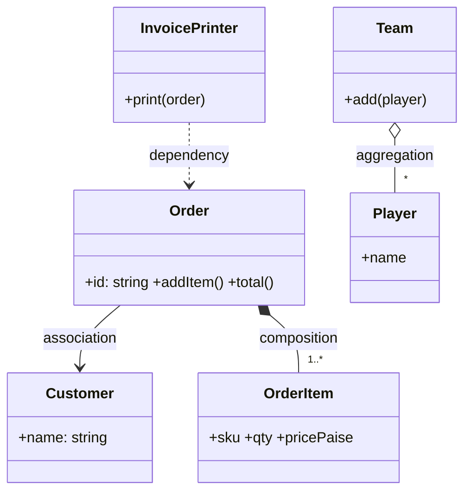

# Relationships in UML

| Relationship | Meaning | Lifetime | Mermaid | In code |
|---|---|---|---|---|
| Dependency | uses temporarily | none | `A ..> B` | method parameter / local variable |
| Association | knows about | independent | `A --> B` | field referencing an object created elsewhere |
| Aggregation | has (whole/part) | part outlives whole | `A o-- B` | collection of objects passed in |
| Composition | owns (whole/part) | part dies with whole | `A *-- B` | whole creates the parts itself |
| Inheritance | is-a | n/a | `B <\|-- A` | `class A extends B` |
| Realisation | implements | n/a | `I <\|.. A` | `class A implements I` |

Multiplicity goes on the line ends: `1`, `0..1`, `*`, `1..*`.

## Exercise diagram to draw
After solving `exercise.ts`, add a Mermaid class diagram for it below this line, labelling each relationship.
